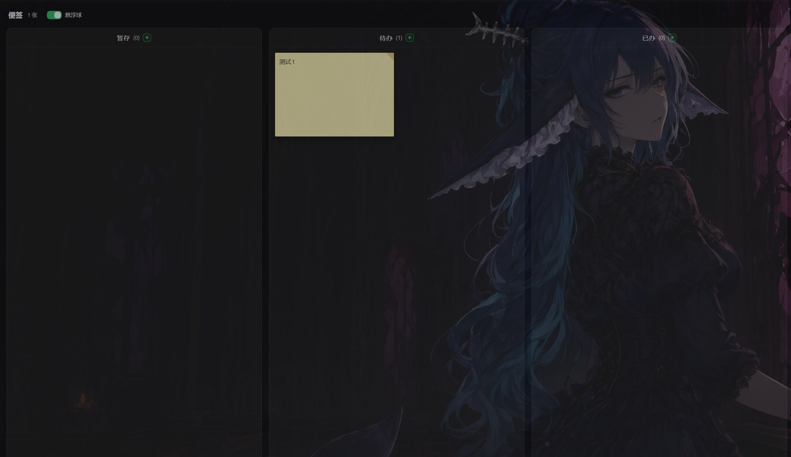
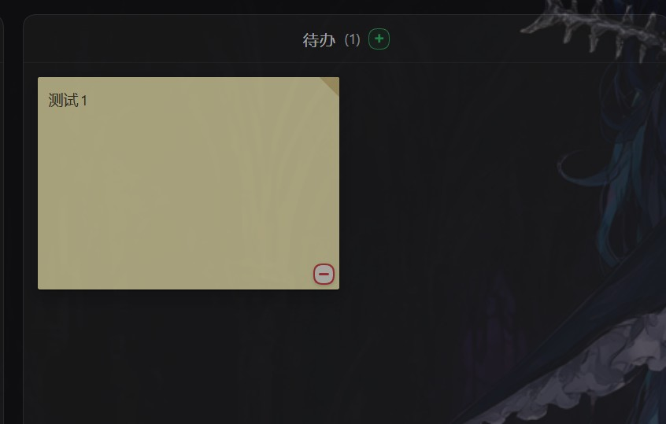
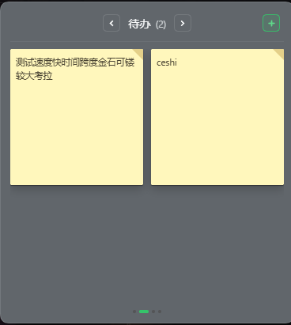
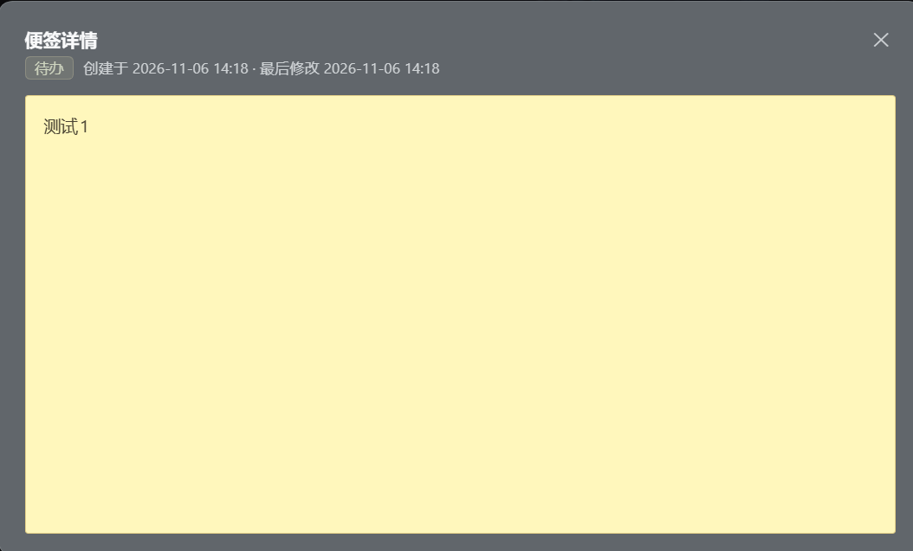

# DSH Sticky Note

给 DSH Web / Desktop 左侧栏加一个「便签」入口：点开是一整页四列便签板（**暂存 / 待办 / 已办 / 临时废弃**），黄色便签纸两列排布，可跨列拖动、双击看详情、悬停删除，删了还能 5 秒内撤销。

还有一个可选的**悬浮球**：开启后全界面常驻一个彩色圆球，点开就能翻看四列便签，还能直接在面板里新建一条、也能点铅笔改已有的一条，不用先切到便签页。

**当前版本：1.3.1** · 适用于 DSH Desktop / DSH Web（Bundle Patch + Client Module）

> 个人项目，只在 DSH Desktop 上实测；DSH 升级后若 Bundle API 有变化可能需要适配。**本插件不修改 DSH 源码**，只用公开插槽（`sidebar.panellist`、`main`、`shell.overlay`）与 Host 的 `webServer` 服务，升级 DSH 不会覆盖它。



标题栏左侧是便签总张数，右侧那个开关就是悬浮球的入口（默认关闭）。

## 功能

### 便签板

| 功能 | 说明 |
|---|---|
| 侧栏入口 | 左侧栏「任务看板」之后多一个「便签」，点击整页切到便签板 |
| 四列 | 暂存 / 待办 / 已办 / 临时废弃，等高铺满，列标题带 `(N)` 计数，空列显示 `(0)` |
| 便签卡 | 每行 2 张，固定高 162px，浅黄纸 + 右上折角 |
| 文字截断 | 超过卡片高度时，末尾 3 个字的位置换成 `...`；全文在详情里看 |
| 添加 | 列标题后的绿色圆圈「＋」→ 居中弹窗（670 宽 / 输入区 338 高），`Ctrl+Enter` 保存，落该列末尾 |
| 删除 | 鼠标悬停卡片右下角出现红色「禁止」标，点一下直接删 |
| 撤销 | 删除后底部提示保留 **5 秒**，点「撤销」原样放回 |
| 拖动 | 列内重排、跨列移动；绿虚线是落点，目标列描边变绿 |
| 单击选中 | 单击卡片轻微抖动（±2°，200ms）后停在选中态（绿色描边），点空白或 Esc 取消 |
| 字数上限 | 单张 2000 字（按字符数算，emoji 不会被切一半） |
| 持久化 | 全局一份，存在 `$DSH_HOME\sticky-note\board.json`，重装插件、重启 DSH 都不丢 |

悬停时右下角出现红色「禁止」标，点它直接删除：



### 悬浮球

一个可选的随手入口：球一直飘在所有页面上，点开就能看便签，不用先切到便签页。



| 功能 | 说明 |
|---|---|
| 开关 | 便签页标题栏「N 张」右侧，**默认关闭**；打开后球立刻出现在右下角 |
| 球 | 56px 彩色圆球（橙→粉→紫渐变，中间一个「签」），按住可拖，松手记住位置 |
| 常驻 | 全界面显示 —— 切到对话页、任务看板、设置页都还在 |
| 点开 | 点球弹出小面板，此时**球隐藏**（不占视线）；关闭面板后球回到原位 |
| 面板 | 顶部 `‹ 待办 (7) ›` 切四列，2×2 最多四张，滚轮翻行且**不出现滚动条**，底部小点指示当前列 |
| 新建 | 有便签时用头部右上角的绿框「＋」；这一列是空的时候，整块空白本身就是一个大按钮（虚线框 + 大「＋」），点哪里都行 |
| 加到哪列 | 自动带出**你正在看的那一列**，弹窗里已经写好 `添加到 · 待办`，不用再选 |
| 保存之后 | 面板不关、张数 +1，并自动翻到新便签所在的页面（新便签排在列尾，不翻页会看不见） |
| 看详情 | 点面板里任一张 → **只读**详情（右上角 × 能关，也可以 ← 回退或 `Esc` 回列表） |
| 回退 | 详情标题栏的 **←**（铅笔右边）：回到刚才那个便签选择弹窗，**仍是那一列、那一页**，刚读的那张描绿框；编辑态不显示 |
| 编辑 | 只读详情里点标题右边的**铅笔**进入编辑；底栏只有**字数 / 保存**（没有删除、没有关闭）。点「保存」后**回到只读样子、弹窗不关**，改完的字立刻生效 |
| 关闭面板 | 点面板外任意处、或按 `Esc`；弹窗开着时第一次 `Esc` 退一步（详情 → 列表），第二次才收面板 |
| 记住位置 | 面板拖到哪就停在哪：看详情再 ← 回退、或关掉重开，都还在刚才那个位置（刷新页面才归零）。拖完之后再拖动球，面板也不会跟着跑 |

### 详情与浮层

添加框、便签详情、悬浮球面板都能**按住顶部拖动**，松手留在原处；位置不会拖出屏幕。每次打开都回到默认位置。

从左侧栏双击卡片打开的是**可编辑**详情（底部有删除 / 关闭 / 保存）；从悬浮球打开的是**只读**详情，想改就点标题旁的铅笔：



> **点外面不会关**（1.3.1 起）：详情和添加框都不会因为点了弹窗外的地方而消失，避免误点丢草稿。要关请用右上角 ×、底部「关闭 / 取消」或 `Esc`。

## 安装

这是 **DSH 本地 Bundle**，不是 npm 包，不需要 `npm install`。

1. 从 [GitHub Releases](https://github.com/mr-zhok/dsh-sticky-note/releases) 下载 `zhang-dsh-sticky-note-<version>.tgz`；
2. 打开 DSH 的插件管理 / Bundle 安装入口，选择「安装本地 Bundle」；
3. 选中 `.tgz` 确认安装，然后**刷新页面**；没出现或还是旧版本就彻底重启 DSH。

> 不同 DSH 版本入口名称可能不同，核心是安装本地 Bundle 的 `.tgz`。

## 使用

### 便签板

1. 点左侧栏「便签」；
2. 点任意列标题后的绿色「＋」新建，写完 `Ctrl+Enter` 或点「保存」；
3. 拖动卡片在列内排序、或拖到别的列；
4. **双击**卡片看全文并编辑；**单击**只是选中（会抖一下）；
5. 鼠标移到卡片上，右下角出现红色「禁止」标，点它删除，5 秒内可撤销。

### 悬浮球

1. 在便签页标题栏打开「悬浮球」开关；
2. 球会出现在右下角，按住可拖到顺手的位置；
3. 切到任何页面球都在 —— 点它就能翻便签；
4. 左右箭头切列（到两端会置灰），滚轮翻看更多，点任一张看全文；
5. 想加一条：点头部右上角的「＋」（这一列是空的时候，直接点中间那块空白）；
6. 想改一条：点卡片看详情 → 点标题右边的**铅笔** → 改完点「保存」，回到只读样子、弹窗不关；
7. 想退回列表：点标题栏的 **←**（或按 `Esc`），会回到刚才那一列那一页，刚看的那张有绿框；
8. 点面板外或按 `Esc` 收起，球会回来（面板拖到哪，下次打开还在哪）。

> 球被拖到屏幕上半屏时，面板会向下展开，避免出屏。

## 数据

```
$DSH_HOME\sticky-note\board.json
```

- 全局一份，所有会话、所有工作区共用；
- 便签和悬浮球的位置、开关都在这一个文件里；
- 纯文本，可直接备份/编辑；文件损坏时会回退成空板，不会白屏；
- 写入走临时文件 + 原子改名，断电不会留下半个文件。

## 已知限制

- 触屏设备没有悬停，删除标不出现，请用详情框里的「删除」；
- 悬浮球的面板一屏最多 4 张，更多的靠滚轮翻行；
- 列内滚动条是隐藏的，只能滚轮 / 触控板滚；
- 便签纸固定浅黄，暂不支持改底色（计划中）；
- 单张 2000 字，超出请拆开；
- 详情与添加框拖过之后不会被记住，每次打开都回到默认位置（只有悬浮球小面板的位置会记住）；

## 更新记录

| 版本 | 内容 | 日期 |
|---|---|---|
| **1.3.1** | **详情能回退了，误点也不会丢内容**：<br>· 悬浮球只读详情铅笔右边多一个 **←**，点它退回便签选择弹窗 —— 还是那一列、那一页，刚读的那张描绿框；`Esc` 也复用成回退，第一次退回列表、第二次才收面板。<br>· **点弹窗外不再关闭**，详情和添加框都一样，只能按 × / 关闭 / 取消 / `Esc`。<br>· 小面板**记住你拖到的位置**：退回来、关掉重开都还在那（刷新归零），拖过面板后再拖动球也不会跟着跑。<br>· 顺带修掉两个拖动相关的老问题：连续拖第二次会漂移、面板跟着球跑 | 2026-11-23 |
| **1.3.0** | **悬浮球详情可以编辑了**：标题右边加铅笔，点开进入编辑态；底栏只有字数 / 保存，点保存后回到只读样子、**弹窗不关**，改完立刻生效 | 2026-11-20 |
| 1.2.0 | **悬浮球面板里可以直接新建便签**：有便签时用头部右上角的「＋」，这一列空着时整块空白就是按钮；自动带出当前列，保存后翻到新便签那一页 | 2026-11-20 |
| 1.1.0 | **新增悬浮球**：标题栏开关、全界面常驻可拖动的「签」字圆球、四列切换小面板（滚轮翻行、点卡片看只读详情、点外部收起）；添加框与详情等浮层支持拖动 | 2026-11-06 |
| 1.0.0 | 首个版本：四列便签板、拖动、详情、悬停删除 + 5 秒撤销、单击选中、计数、2000 字上限 | 2026-11-05 |

## 许可

[MIT](LICENSE) © 2026 mr-zhok
